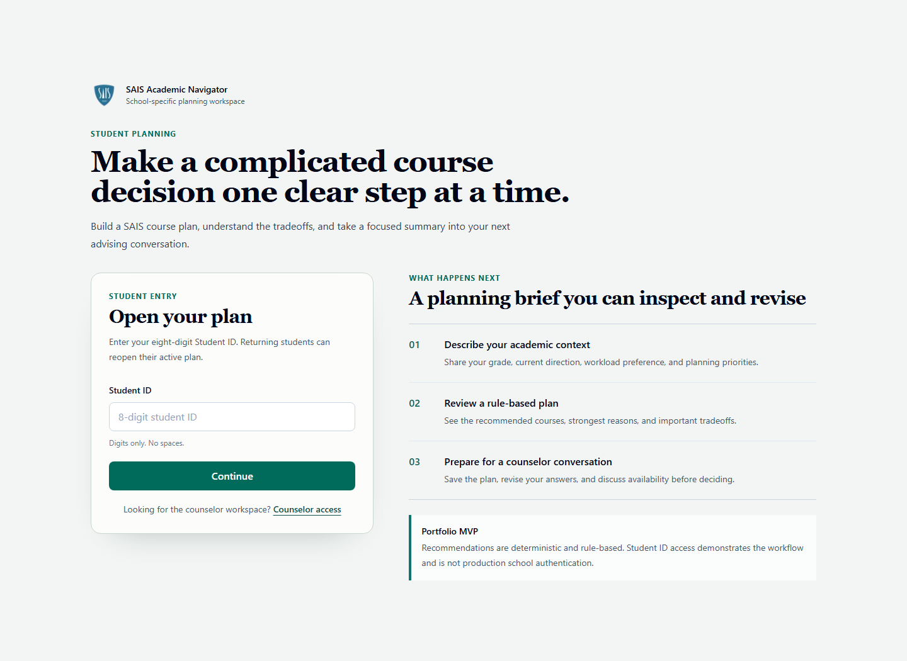
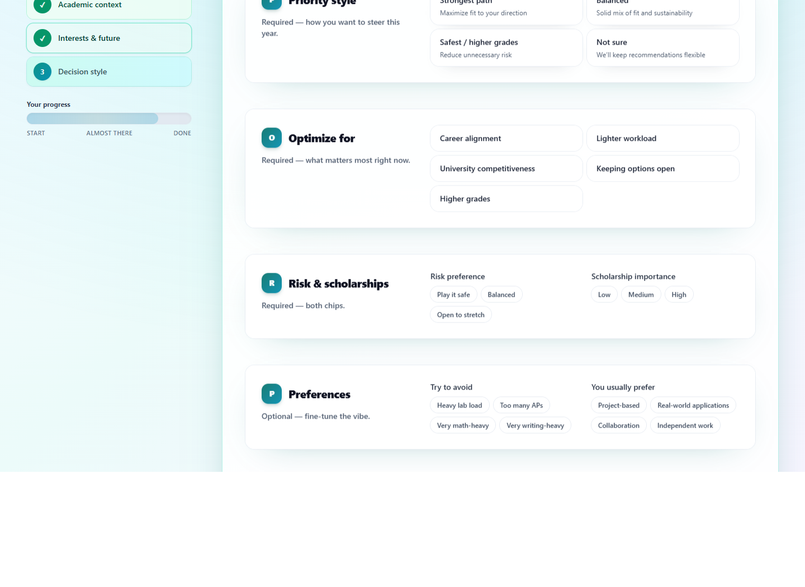
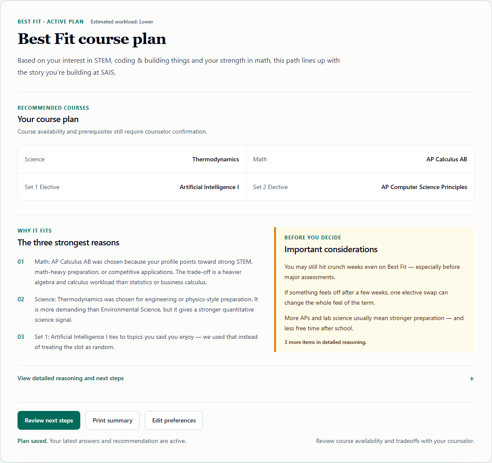
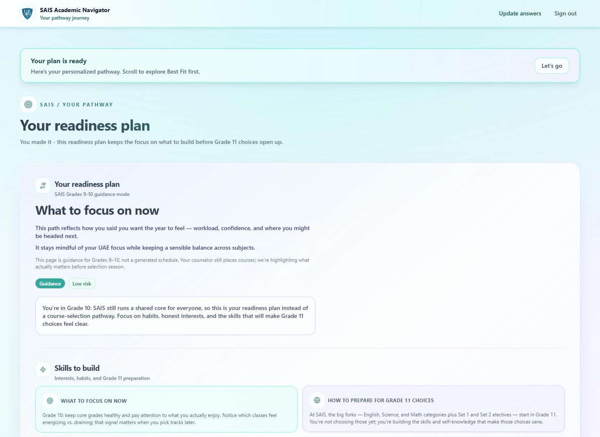
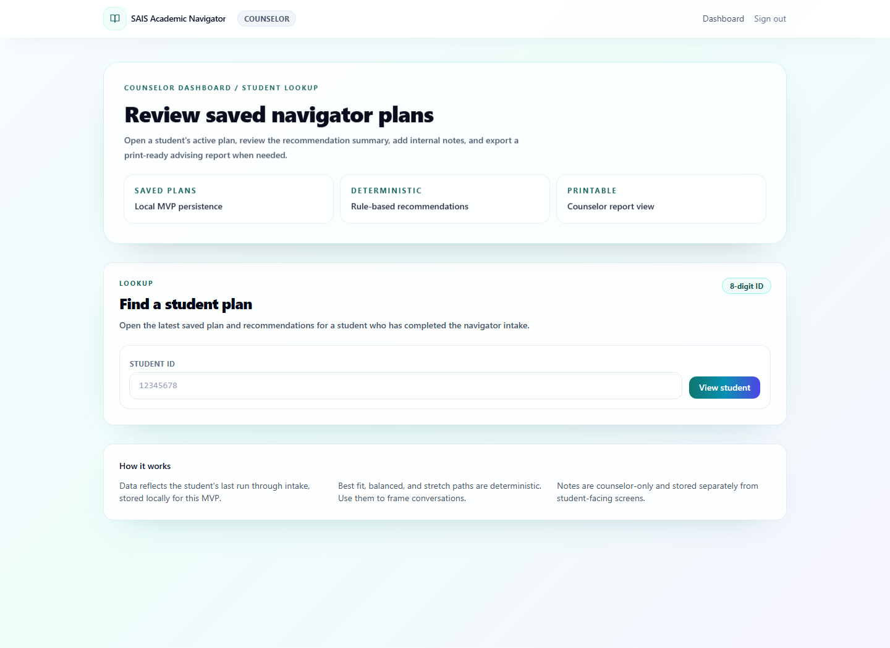
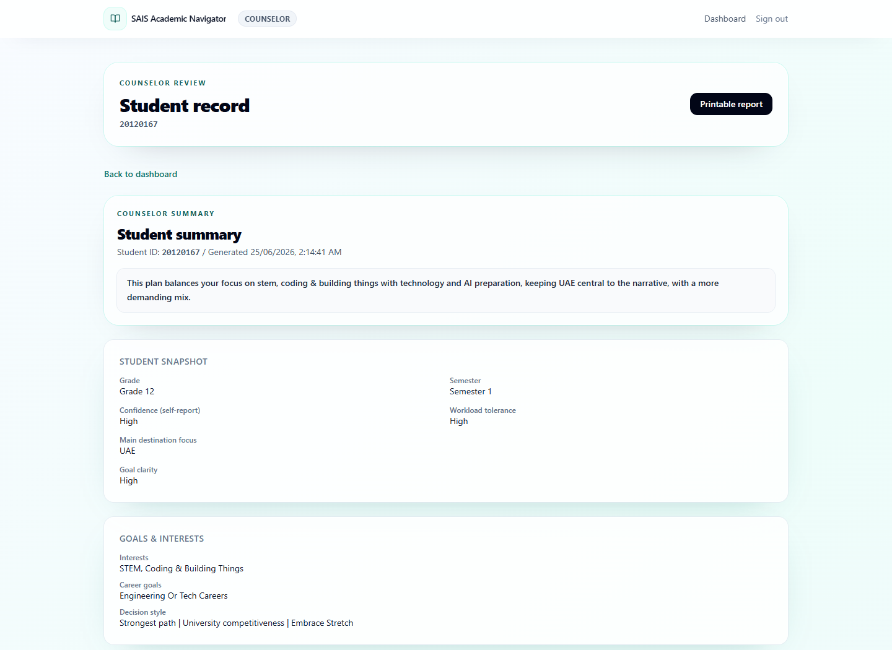
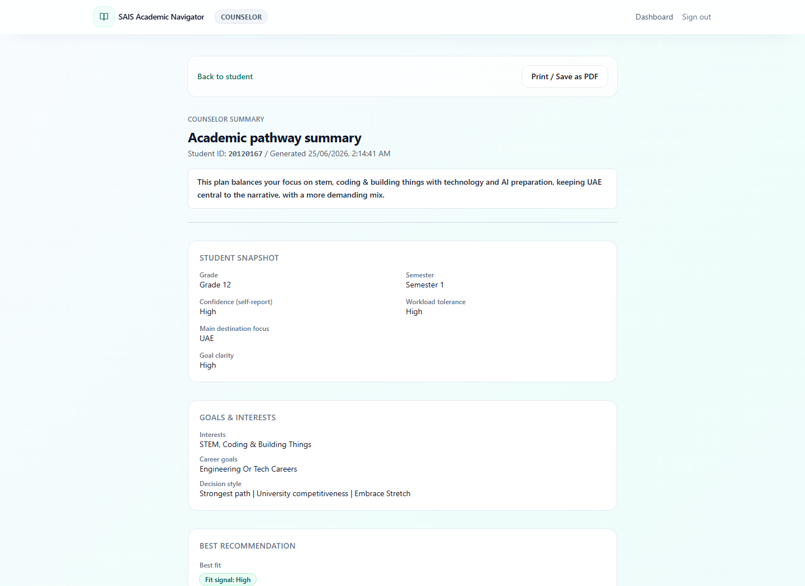

# SAIS Academic Navigator: screenshot gallery

[Project overview](../README.md) · [Demo walkthrough](../DEMO.md)

These screenshots use synthetic demo data. They show the implemented student
and counselor workflows; they do not establish school adoption or validated
advising outcomes.

## Student login

## Guided intake

## Grade 12 pathway recommendations

## Grade 10 readiness plan

## Counselor lookup

## Counselor student summary

## Printable advising report

